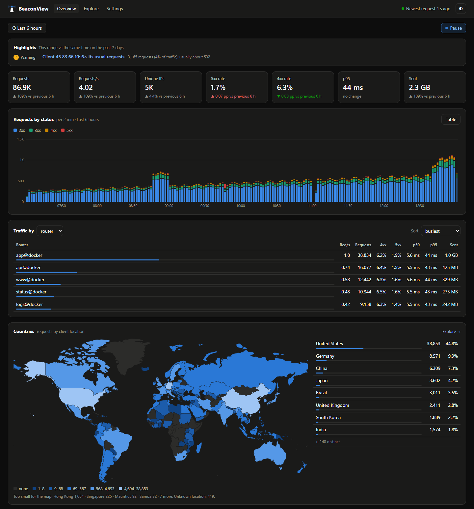
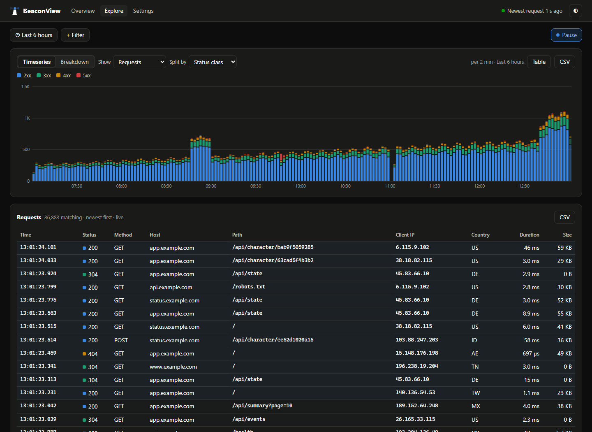
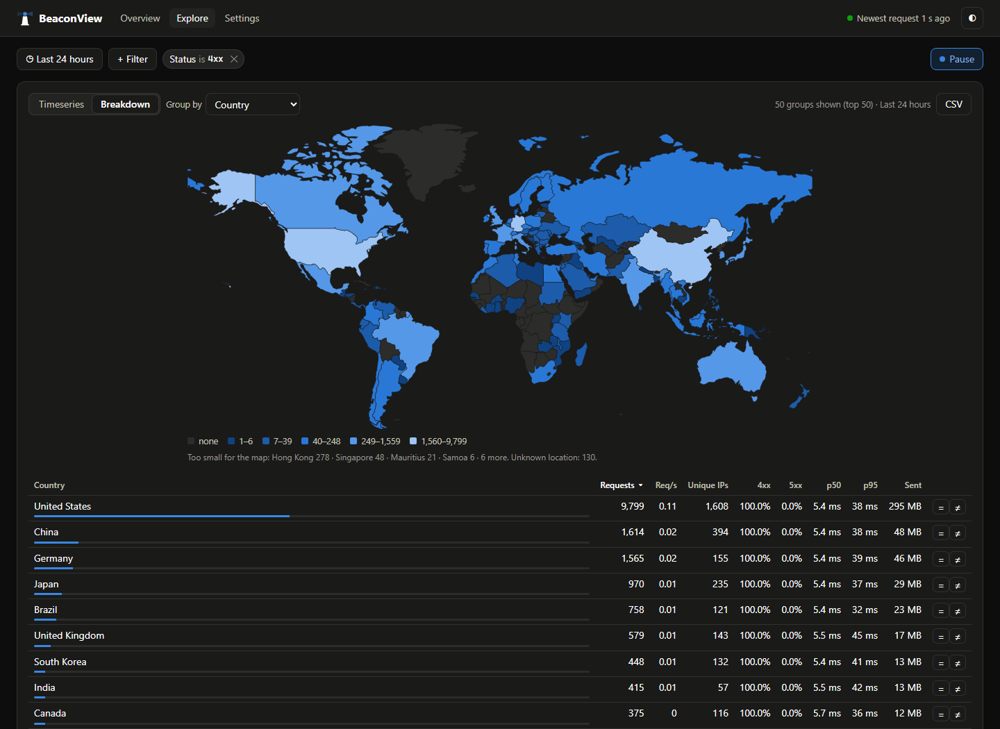

# BeaconView

A self-hosted request explorer for Traefik. BeaconView reads the JSON access log Traefik already writes and keeps a
searchable history of every request: who is hitting what, how often, what they got back, and how fast. It adds no
tracking to your sites and never sits in the request path: if BeaconView is slow or stopped, your traffic is
unaffected.



> **Status: early (v0.2).** Built for one Traefik host with a handful of people looking at it. See
> [the design notes](docs/design.md) for how it works and what is planned.

## What it does

- **Overview** — the whole proxy at a glance: **highlights** of what is unusual against the same time on earlier days
  (a router's 5xx or latency spiking, traffic well above or below its usual level, a new or surging client or
  path); requests, unique IPs, error rates and p95 latency against the previous period; traffic by router, service
  or host; a **map of client countries**; top status codes, paths, client IPs and user agents; the latest server
  errors. Every value links into Explore.
- **Explore** — ask a question: filter by host, path (`/api/*`), status (`4xx`, `!304`), client IP or range, user
  agent, duration or any header Traefik keeps. See it over time (requests, bytes, response time p50/p95/p99, unique
  IPs, error rate) or broken down by any field with every measure, with the matching requests underneath. Hover a
  request to see where it sits on the chart; click a bar to read the requests behind it. Every view is a link.
- **Live** — the preset ranges stay current, pushed from the server as requests are written: "Last 5 minutes"
  scrolls with new 2-second bars, "Last hour" adds a bar a minute, and new requests appear in the log about a second
  after Traefik logs them. Pause freezes the window as a fixed range you can share.
- **CSV export** — the requests behind any Explore view (up to a million rows, streamed), its chart, or its
  breakdown, with the same filters. Values a spreadsheet would run as formulas are escaped.
- **Settings** — what is being read and how far along, database size, and retention or IP handling you can change
  while it runs.

| Explore | Breakdown by country |
|---|---|
|  |  |

## Quick start

**1. Traefik writes a JSON access log to a file** (in `traefik.yml`, or the equivalent flags):

```yaml
accessLog:
  filePath: /var/log/traefik/access.log
  format: json
  fields:
    headers:
      defaultMode: drop
      names:
        User-Agent: keep
        Referer: keep
        # CF-Connecting-IP: keep     # behind Cloudflare, and set CLIENT_IP_HEADER below
```

Rotate it as you already do (logrotate's `create` and `copytruncate` both work); BeaconView follows rotations.

**2. Run BeaconView next to it**, with the log directory mounted read-only:

```yaml
services:
  beaconview:
    image: ghcr.io/nintynien/beaconview:latest
    restart: unless-stopped
    environment:
      ACCESS_LOG: /var/log/traefik/access.log
      RETENTION_DAYS: "7"
      BACKFILL: "1"                 # first start: also read the rotated logs already on disk
      # CLIENT_IP_HEADER: CF-Connecting-IP
    volumes:
      - /var/log/traefik:/var/log/traefik:ro
      - beaconview-data:/data
volumes:
  beaconview-data:
```

**3. Put it behind authentication** (below), route it through Traefik, and open it.
[docker-compose.example.yml](docker-compose.example.yml) has the full version with Traefik labels and basic auth.

Images: `:latest` is the newest release, `:0.2` / `:0.2.0` pin one, `:edge` follows the main branch.
Both `linux/amd64` and `linux/arm64`.

## Authentication

BeaconView has no user accounts. It shows visitor IPs and request paths, and its settings page can change how long
data is kept, so **put it behind authentication before anyone else can reach it**:

- **Traefik basic auth** (simplest): add a `basicauth` middleware to BeaconView's router, as in
  [docker-compose.example.yml](docker-compose.example.yml).
- **Single sign-on**: forward-auth to [Authelia](https://www.authelia.com/), [Authentik](https://goauthentik.io/) or
  [oauth2-proxy](https://oauth2-proxy.github.io/oauth2-proxy/), the same way you protect your other internal apps.
- **No proxy in front?** Set `BASIC_AUTH_USER` and `BASIC_AUTH_PASSWORD` and BeaconView asks for them itself.

`/healthz` always answers without credentials (it says only whether ingest is running), for container health checks.

## Configuration

| Variable | Default | |
|---|---|---|
| `ACCESS_LOG` | `/var/log/traefik/access.log` | the log to follow |
| `ACCESS_LOGS` | | several logs on one host: `edge=/logs/a.log,internal=/logs/b.log` |
| `INSTANCE_NAME` | hostname | label for `ACCESS_LOG` |
| `LOG_FORMAT` | `traefik` | |
| `RETENTION_DAYS` | `7` | every request is kept this long |
| `ROLLUP_RETENTION_DAYS` | `90` | per-minute totals (charts, counts, percentiles) are kept this long |
| `BACKFILL` | `0` | on first start, also read the rotated logs already on disk (`access.log.1`, `.gz` files) |
| `CLIENT_IP_HEADER` | | e.g. `CF-Connecting-IP` behind Cloudflare (Traefik must keep that header) |
| `ANONYMIZE_IPS` | `0` | store /24 (IPv4) and /48 (IPv6) networks instead of addresses |
| `GEOIP` | `auto` | country per client IP: `auto` downloads DB-IP's free database monthly, a path uses your own `.mmdb` (e.g. MaxMind GeoLite2-Country), `off` turns it off |
| `DB_MEMORY_LIMIT` | `512MB` | DuckDB's memory cap |
| `DB_THREADS` | `2` | DuckDB's threads; more makes long-range queries faster |
| `BASIC_AUTH_USER` / `BASIC_AUTH_PASSWORD` | | optional built-in authentication |
| `DATA_DIR` | `/data` | where the database lives |
| `PORT` | `8080` | |

Retention, the client IP header and IP anonymization can also be changed on the **Settings** page while BeaconView
runs. A value set by an environment variable wins and is shown locked there, so your compose file stays the source
of truth for whatever it sets; the rest are saved in BeaconView's database.

### Countries

With `GEOIP=auto` BeaconView downloads DB-IP's free *IP to Country Lite* database (about 8 MB, refreshed monthly)
into `DATA_DIR/geoip` and looks up each client IP **on your machine**: no visitor IP is ever sent anywhere, the only
network traffic is that monthly download from `download.db-ip.com`. If the download fails, ingest carries on without
countries and fills them in once the database arrives. DB-IP's licence (CC BY 4.0) asks for a credit on pages that
show its results, so those pages carry a small "IP Geolocation by DB-IP" link; with your own database (`GEOIP=` a
path) there is none. Countries are by ISO code (`country=US` in a filter); `ZZ` is a private or unknown address.
The map's outlines are [Natural Earth](https://www.naturalearthdata.com/) (public domain), shipped in the image.

## How much disk and memory

Every request is stored in a compressed columnar database (DuckDB), about **20–35 bytes per request** depending on
how varied your paths and user agents are:

| Traffic | Per day | 7 days | 30 days |
|---|---|---|---|
| 3 requests/s | ~8 MB | ~55 MB | ~250 MB |
| 30 requests/s | ~80 MB | ~550 MB | ~2.5 GB |
| 300 requests/s | ~0.7 GB | ~3–5 GB | ~15–25 GB |

Per-minute totals for long ranges add little (a few MB a month). Memory is typically 100–350 MB, bounded by
`DB_MEMORY_LIMIT`. Measured on synthetic traffic: ingest keeps up with 3,000 requests/s using about a tenth of one
CPU core, and catches up on a backlog at 40,000–55,000 lines/s.

## Limitations

BeaconView is deliberately small. What it does not do yet:

- **One Traefik host.** It reads log files on the machine it runs on (several logs there are fine, via
  `ACCESS_LOGS`). Collecting from Traefik on other machines is planned (an agent mode of the same image), not built.
- **Traefik's JSON access log only.** Caddy and nginx JSON formats are planned; Traefik's text (CLF) format is not.
- **No alerting.** Highlights show what is unusual when you look; nothing pages you. Pair it with your monitoring
  for that.
- **Country, not city.** Locations are per country; the free city databases are large and often wrong at that
  level.
- **A handful of viewers.** Built for a team, not a public dashboard: live updates hold one connection per open
  tab (up to 50, then pages fall back to polling), and every query runs in the one container.
- **No user accounts.** Authentication is your proxy's job (see above); everyone who gets in sees everything.
- **History starts when it does.** Backfill reads the rotated logs still on disk; anything older is gone. Traffic
  from before BeaconView existed cannot be compared against.
- **Retention is one number per kind of data.** Every request for `RETENTION_DAYS`, per-minute totals for
  `ROLLUP_RETENTION_DAYS`; no per-host or per-path retention.

Ideas being considered next are listed in [docs/design.md](docs/design.md).

## How it works

One container, one process: a thread tails the log (following rotations, saving its position with every batch so a
restart neither loses nor repeats a line), writes batches into DuckDB, keeps per-minute totals with latency
histograms for fast long-range charts, and prunes old data; a small HTTP server serves the pages and a JSON API, and
pushes live updates with Server-Sent Events. Details, measurements and the reasoning behind each choice are in
[docs/design.md](docs/design.md).

The JSON API the pages use is yours too: `/api/summary`, `/api/series`, `/api/breakdown`, `/api/top`, `/api/logs`,
`/api/highlights` (filters as URL parameters, the same as an Explore link), `/api/export` for CSV, `/api/status`,
and `/api/stream` for live updates.

## Development

```sh
python -m venv .venv && .venv/bin/pip install -r requirements-dev.txt
.venv/bin/python -m playwright install chromium             # for the browser tests in tests/ui
.venv/bin/python -m pytest                                  # everything; tests/ui is skipped without Playwright
python tools/genlog.py ./demo/access.log --realistic --rate 20 --history 6 --seconds 3600 &   # a day-like demo
ACCESS_LOG=./demo/access.log DATA_DIR=./demo/data BEACONVIEW_DEV=1 .venv/bin/python -m beaconview
python tools/smoke.py http://127.0.0.1:8080 <rows>         # what CI checks against the built image
python tools/bench.py ./bench.duckdb --days 7 --rate 300    # storage and query timings
python tools/build_world.py ne_110m_admin_0_countries.geojson   # rebuild the map outlines (static/world.json)
```

`BEACONVIEW_DEV=1` serves the files under `beaconview/static/` fresh on every request, so page edits show on reload.

## License

MIT
